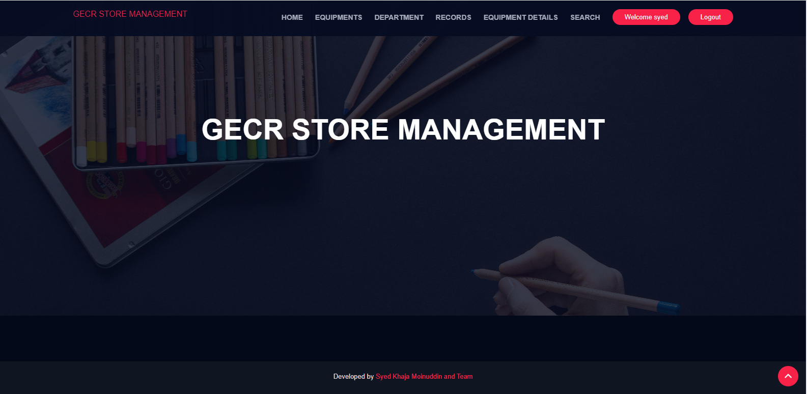

# GECR STORE - Equipment Management System



An equipment inventory management system with comprehensive functionality for managing laboratory equipment across departments.

## 🌐 Live Demo

**Try it now:** [https://s-yed.github.io/GECR-STORE/](https://s-yed.github.io/GECR-STORE/)

**Login with any credentials:**
- Email: `demo@example.com` (or any email)
- Password: `password123` (or any password)

The demo includes 21+ sample equipment items across 4 departments with full functionality.

## ✨ Features

- **Equipment Management** - Add, edit, delete, and search equipment records
- **Department Management** - Organize equipment by departments
- **User Authentication** - Secure login/signup system
- **Audit Trail** - Track all equipment operations with detailed logs
- **Real-time Search** - Live search with debouncing
- **Export Functionality** - Export data to CSV format
- **Responsive Design** - Works on desktop, tablet, and mobile
- **Demo Mode** - Run without database setup for testing

## 🚀 Quick Start (Demo Mode)

**Option 1: Try Online Demo**
- Visit: [https://s-yed.github.io/GECR-STORE/](https://s-yed.github.io/GECR-STORE/)
- Login with **any email/password** (e.g., `demo@example.com` / `password123`)

**Option 2: Run Locally**
```bash
git clone https://github.com/S-YED/GECR-STORE.git
cd GECR-STORE
npm install
npm run dev
```
Open `http://localhost:3000` and login with any email/password.

## 🛠️ Tech Stack

- **Frontend**: Vite + Vanilla JavaScript
- **Database**: Supabase (PostgreSQL)
- **Styling**: Custom CSS with luxury effects
- **Authentication**: Supabase Auth
- **Build Tool**: Vite

## 📋 Prerequisites

- **Node.js 16+** - [Download here](https://nodejs.org/)
- **Git** - [Download here](https://git-scm.com/)
- **Supabase Account** (optional for demo) - [Sign up here](https://supabase.com/)

## 🔧 Installation & Setup

### 1. Clone Repository
```bash
git clone https://github.com/S-YED/GECR-STORE.git
cd GECR-STORE
```

### 2. Install Dependencies
```bash
npm install
```

### 3. Choose Your Mode

#### Option A: Demo Mode (Recommended for Testing)
The project runs in demo mode by default with sample data. No additional setup required.

```bash
npm run dev
```

#### Option B: Production Mode (With Real Database)

1. **Create Supabase Project**:
   - Go to [supabase.com](https://supabase.com)
   - Create a new project
   - Wait for setup to complete

2. **Get Credentials**:
   - Go to Settings → API
   - Copy your Project URL and anon/public key

3. **Configure Environment**:

   - Copy `.env.example` to `.env` (run `cp .env.example .env`)
   - Replace the demo values in `.env` with your credentials:
   ```env
   VITE_SUPABASE_URL=https://your-project.supabase.co
   VITE_SUPABASE_SUPABASE_ANON_KEY=your-anon-key-here
   ```

4. **Setup Database**:
   - Go to SQL Editor in Supabase
   - Run the migration file: `supabase/migrations/20251010090639_create_equipment_inventory_schema.sql`

5. **Start Application**:
   ```bash
   npm run dev
   ```

## 🎯 Usage

### Demo Mode
- **Login**: Use any email/password (e.g., `demo@example.com` / `password123`)
- **Sample Data**: 21+ equipment items across 4 departments
- **Full Functionality**: All features work with mock data
- **Live Demo**: [https://s-yed.github.io/GECR-STORE/](https://s-yed.github.io/GECR-STORE/)

### Production Mode
- **Register**: Create a new account
- **Login**: Use your registered credentials
- **Real Database**: All data persists in Supabase

### Core Features
1. **Dashboard** - View equipment inventory with statistics
2. **Add Equipment** - Fill in equipment details and assign to departments
3. **Search & Filter** - Find equipment by name, order number, or supplier
4. **Edit/Delete** - Modify or remove equipment records
5. **Departments** - Manage organizational departments
6. **Audit Logs** - View detailed change history
7. **Export** - Download data as CSV files

## 📁 Project Structure

```
GECR-STORE/
├── src/
│   ├── components/          # Reusable UI components
│   │   └── Navbar.js
│   ├── lib/                # Core libraries
│   │   ├── auth.js         # Authentication logic
│   │   ├── router.js       # Client-side routing
│   │   └── supabase.js     # Database configuration
│   ├── pages/              # Application pages
│   │   ├── DashboardPage.js
│   │   ├── LoginPage.js
│   │   ├── DepartmentsPage.js
│   │   └── AuditPage.js
│   ├── styles/
│   │   └── main.css        # Premium styling
│   ├── utils/
│   │   └── helpers.js      # Utility functions
│   └── main.js             # Application entry point
├── supabase/
│   └── migrations/         # Database schema
├── static/                 # Static assets
├── templates/              # Legacy Flask templates
├── .env.example            # Environment variables template
├── package.json
├── vite.config.js
└── README.md
```

## 🎨 UI Features

- **Glassmorphism Effects** with backdrop blur
- **Animated Components** with smooth transitions
- **Responsive Design** for all screen sizes
- **Custom Scrollbars** with gradient styling

## 🔒 Security Features

- **Row Level Security (RLS)** on all database tables
- **User Authentication** with secure password hashing
- **Protected Routes** requiring authentication
- **Audit Logging** for all data changes
- **Input Validation** and sanitization

## 📊 Sample Data

The demo includes realistic equipment data:
- Signal generators, oscilloscopes, CNC machines
- Network equipment, testing instruments
- Pricing from ₹3,500 to ₹8,50,000
- Multiple departments and lab locations

## 🚀 Deployment

### Build for Production
```bash
npm run build
```

### Deploy to Vercel
```bash
npm install -g vercel
vercel --prod
```

### Deploy to Netlify
```bash
npm run build
# Upload dist/ folder to Netlify
```

## 🤝 Contributing

1. Fork the repository
2. Create feature branch (`git checkout -b feature/AmazingFeature`)
3. Commit changes (`git commit -m 'Add AmazingFeature'`)
4. Push to branch (`git push origin feature/AmazingFeature`)
5. Open Pull Request

## 📝 License

This project is open source and available under the [MIT License](LICENSE).

## 👨‍💻 Author

**@S-YED** - [GitHub Profile](https://github.com/S-YED)

## 🆘 Troubleshooting

### Common Issues

**Blank Page**: 
- Check browser console for errors
- Ensure Node.js 16+ is installed
- Try `npm install` again

**Login Issues in Demo Mode**:
- Any email/password works in demo mode
- Check console for "Running in demo mode" message

**Database Connection Issues**:
- Verify Supabase credentials in `.env`
- Check if migration was run successfully
- Ensure project is not paused in Supabase

**Build Errors**:
- Delete `node_modules` and run `npm install`
- Check Node.js version with `node --version`

### Getting Help

- Open an issue on GitHub
- Check existing issues for solutions
- Review console logs for error details

---

**🌟 Star this repository if you found it helpful!**
